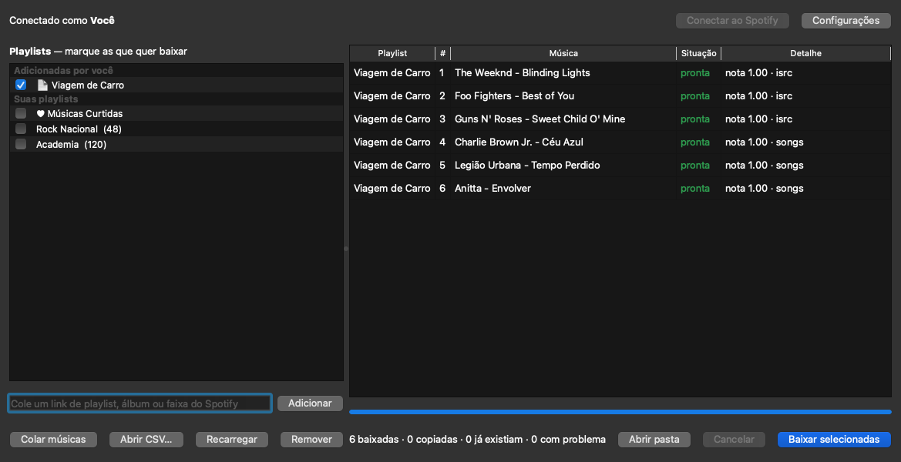

# FaixaMP3

Transforma suas playlists do Spotify em pastas de MP3 prontas para o pendrive do carro.

Você escolhe as playlists, o FaixaMP3 encontra cada música no YouTube Music, baixa, converte para MP3 com
capa e informações certas, e organiza tudo em uma pasta por playlist. Rodando de novo, ele só baixa o que
mudou.



**Funciona no macOS e no Windows.**

---

## Sumário

- [O que ele faz](#o-que-ele-faz)
- [Instalação no macOS](#instalação-no-macos)
- [Instalação no Windows](#instalação-no-windows)
- [Configurar o Spotify (uma vez só)](#configurar-o-spotify-uma-vez-só)
- [Como usar](#como-usar)
- [Playlists de outras pessoas](#playlists-de-outras-pessoas)
- [Configurações](#configurações)
- [Colocando no pendrive](#colocando-no-pendrive)
- [Como a música certa é escolhida](#como-a-música-certa-é-escolhida)
- [Linha de comando](#linha-de-comando)
- [Problemas comuns](#problemas-comuns)
- [Privacidade](#privacidade)
- [Aviso](#aviso)

---

## O que ele faz

- **Login oficial do Spotify.** Você entra pelo site do Spotify; o FaixaMP3 nunca vê sua senha.
- **Escolhe a gravação certa.** Procura pelo código da gravação (ISRC) e por artista/título, compara título,
  artista e duração, e recusa versões ao vivo, cover, remix, karaokê etc. quando a original não é assim.
- **Baixa várias músicas ao mesmo tempo** (4 por padrão).
- **Sincroniza.** Rodar de novo baixa só as músicas novas, renomeia as que mudaram de posição e reaproveita
  (copia sem baixar) músicas que já estão em outra playlist.
- **MP3 pensado para som de carro:**
  - 320 kbps, 44,1 kHz;
  - tags ID3v2.3 + ID3v1 (o que a maioria dos rádios lê);
  - capa 500×500 em JPEG comum (muitos rádios não leem JPEG progressivo);
  - arquivos numerados na ordem da playlist: `01 - Artista - Música.mp3`;
  - nomes sem emojis e sem caracteres proibidos em pendrive (FAT32/exFAT);
  - opcional: igualar o volume entre as músicas e tirar acentos dos nomes.
- **Avisa o que faltou.** Músicas não encontradas ficam listadas em `_faltando.txt` dentro da pasta.

---

## Instalação no macOS

### 1. Instale as ferramentas

Abra o **Terminal** (Cmd+Espaço, digite "Terminal") e instale o [Homebrew](https://brew.sh), se ainda não
tiver:

```bash
/bin/bash -c "$(curl -fsSL https://raw.githubusercontent.com/Homebrew/install/HEAD/install.sh)"
```

Depois instale o que o FaixaMP3 usa:

```bash
brew install uv ffmpeg deno git
```

| Ferramenta | Para quê |
|---|---|
| `uv` | Instala o Python e as bibliotecas do app automaticamente |
| `ffmpeg` | Converte o áudio para MP3 e ajusta as capas |
| `deno` | Necessário para o YouTube liberar o download |
| `git` | Baixa o código do FaixaMP3 |

### 2. Baixe o FaixaMP3

```bash
cd ~/Documents
git clone https://github.com/rildojunior/faixamp3.git
cd faixamp3
```

### 3. Abra o app

```bash
uv run faixamp3-gui
```

Na primeira vez demora um pouco (o `uv` baixa o Python e as bibliotecas). Depois é rápido.

### 4. (Opcional) Gere o aplicativo para abrir sem Terminal

```bash
uv run python packaging/build.py
```

O app fica em `dist/FaixaMP3.app`. Arraste para a pasta **Aplicativos** e abra pelo Launchpad como qualquer
outro app.

---

## Instalação no Windows

### 1. Instale as ferramentas

Abra o **PowerShell** (botão Iniciar, digite "PowerShell") e rode:

```powershell
winget install astral-sh.uv
winget install Gyan.FFmpeg
winget install DenoLand.Deno
winget install Git.Git
```

**Feche e abra o PowerShell de novo** depois de instalar, para o Windows encontrar os programas novos.

| Ferramenta | Para quê |
|---|---|
| `uv` | Instala o Python e as bibliotecas do app automaticamente |
| `ffmpeg` | Converte o áudio para MP3 e ajusta as capas |
| `deno` | Necessário para o YouTube liberar o download |
| `git` | Baixa o código do FaixaMP3 |

### 2. Baixe o FaixaMP3

```powershell
cd $HOME\Documents
git clone https://github.com/rildojunior/faixamp3.git
cd faixamp3
```

> Sem git? Na página do projeto clique em **Code → Download ZIP**, extraia e abra o PowerShell dentro da pasta.

### 3. Abra o app

```powershell
uv run faixamp3-gui
```

### 4. (Opcional) Gere o executável

```powershell
uv run python packaging/build.py
```

O programa fica em `dist\FaixaMP3\FaixaMP3.exe`. Crie um atalho dele na Área de Trabalho. Para levar o
programa para outro PC sem instalar ffmpeg e deno, copie `ffmpeg.exe` e `deno.exe` para `packaging\bin\`
antes de gerar: eles vão embutidos.

---

## Configurar o Spotify (uma vez só)

O FaixaMP3 lê suas playlists pela API oficial do Spotify. Para isso, você cria um "app de desenvolvedor"
gratuito na sua conta e cola o código dele no FaixaMP3. Leva uns 2 minutos.

> A conta que cria o app precisa ser **Spotify Premium** (regra do Spotify desde 2026).

1. Acesse <https://developer.spotify.com/dashboard> e entre com sua conta do Spotify.
2. Aceite os termos de desenvolvedor, se pedir.
3. Clique em **Create app** e preencha:
   - **App name:** `FaixaMP3` (qualquer nome serve)
   - **App description:** `Uso pessoal`
   - **Redirect URIs:** `http://127.0.0.1:8888/callback` → clique em **Add**
   - **Which API/SDKs are you planning to use?** marque **Web API**
4. Aceite os termos e clique em **Save**.
5. Na página do app, abra **Settings** e copie o **Client ID**.
6. No FaixaMP3, clique em **Configurações**, cole o Client ID e salve.
7. Clique em **Conectar ao Spotify**. O navegador abre, você autoriza e pode fechar a aba.

Pronto: suas playlists aparecem na lista.

> Cada pessoa que for usar o FaixaMP3 deve criar o próprio app no Spotify. Se quiser usar o seu app em outra
> conta, adicione o e-mail dela em **User Management** no painel do Spotify (até 5 pessoas).

---

## Como usar

1. **Marque** as playlists que quer baixar na lista da esquerda.
2. Clique em **Baixar selecionadas**.
3. Acompanhe na tabela da direita: cada música passa por *procurando → baixando → convertendo → pronta*.
4. Clique em **Abrir pasta** para ver os MP3.

Outras formas de adicionar músicas (todas aparecem no topo da lista, em **Adicionadas por você**):

| Botão | O que faz |
|---|---|
| **Campo de link + Adicionar** | Cole o link de uma playlist, álbum ou música do Spotify |
| **Colar músicas** | Usa músicas copiadas do app do Spotify (veja abaixo) |
| **Abrir CSV…** | Importa uma playlist exportada em CSV (ex.: pelo [Exportify](https://exportify.app)) |
| **Remover** | Tira da lista um item que você adicionou (ou aperte Delete / botão direito → Remover) |
| **Recarregar** | Atualiza a lista de playlists da sua conta |

**Para atualizar uma playlist** que já baixou, é só marcar e baixar de novo: só as músicas novas são baixadas.

### Colar músicas do app do Spotify

1. No **app do Spotify para computador**, abra a playlist.
2. Clique em qualquer música e aperte **Cmd+A** e depois **Cmd+C** (no Windows: **Ctrl+A** e **Ctrl+C**).
3. No FaixaMP3, clique em **Colar músicas**.
4. Confira os nomes das primeiras músicas e escolha **de qual playlist** elas são (ou "Nova playlist…").

Só são aceitas músicas do Spotify, uma por linha. Qualquer outra coisa na área de transferência é recusada.

---

## Playlists de outras pessoas

O Spotify só entrega a apps pessoais as músicas das playlists **que você criou ou em que colabora**.
Playlists de outras pessoas e as do próprio Spotify (ex.: "Top Brasil") aparecem na seção
**De outras pessoas** e o FaixaMP3 resolve sozinho:

| Tamanho da playlist | Como o FaixaMP3 lê |
|---|---|
| Até 100 músicas | Pelo player público do Spotify (o mesmo que sites usam para mostrar playlists). Automático. |
| Mais de 100 músicas | Abre a playlist no **app do Spotify para computador**, copia todas as músicas (Cmd/Ctrl+A, Cmd/Ctrl+C) e devolve sua área de transferência como estava. |

No **macOS**, a cópia automática precisa de uma permissão (uma vez só):
*Ajustes do Sistema → Privacidade e Segurança → Acessibilidade* → ative o **FaixaMP3** (ou o Terminal, se
estiver rodando com `uv run`).

No **Windows** não precisa de permissão.

Se preferir não deixar o app abrir o Spotify, desmarque essa opção em **Configurações** e use
[Colar músicas](#colar-músicas-do-app-do-spotify).

---

## Configurações

| Opção | Padrão | O que faz |
|---|---|---|
| Client ID | — | Código do seu app no Spotify |
| Pasta das músicas | `Música/FaixaMP3` | Onde as pastas das playlists são criadas |
| Downloads simultâneos | 4 | Quantas músicas baixar ao mesmo tempo |
| Qualidade do MP3 | 320 kbps | 192 / 256 / 320 kbps |
| Igualar o volume | desligado | Deixa todas as músicas com volume parecido (bom para carro) |
| Tirar acentos dos nomes | desligado | Para rádios antigos que mostram acentos errado |
| Copiar playlists grandes pelo app do Spotify | ligado | Ver [Playlists de outras pessoas](#playlists-de-outras-pessoas) |

---

## Colocando no pendrive

Cada playlist vira uma pasta:

```
FaixaMP3/
├── Rock Nacional/
│   ├── 01 - Legião Urbana - Tempo Perdido.mp3
│   ├── 02 - Charlie Brown Jr. - Céu Azul.mp3
│   └── ...
└── Viagem de Carro/
    └── ...
```

Dicas:

- Formate o pendrive em **FAT32** (rádios antigos) ou **exFAT** (pendrives acima de 32 GB, se o rádio aceitar).
- Copie as **pastas** das playlists para a raiz do pendrive.
- No Mac, o Finder cria arquivos ocultos `._*` no pendrive que alguns rádios mostram como músicas
  "quebradas". Para limpar, rode no Terminal: `dot_clean /Volumes/NOME_DO_PENDRIVE`
- Os arquivos `.faixamp3.json` e `_faltando.txt` dentro das pastas são do app; o rádio ignora.

---

## Como a música certa é escolhida

Para cada música, o FaixaMP3 busca no YouTube Music e dá uma **nota de 0 a 1** para cada resultado. A coluna
**Detalhe** mostra a nota da escolhida e por onde ela foi encontrada.

| Critério | Peso |
|---|---|
| Título parecido (ignorando "feat.", "Remastered", "Official Video"…) | 45% |
| Mesmo artista | 25% |
| Mesma duração (até 2 s de diferença = nota cheia; acima de 12 s = descartado) | 30% |

Ajustes: **+0,15** se encontrada pelo código da gravação (ISRC), **+0,08** se for o áudio oficial de estúdio,
**−0,05** para vídeo comum e **−0,10** se o canal não é do artista.

Só é baixado o que tiver **nota 0,70 ou mais**. O que ficar abaixo vai para `_faltando.txt`.

| "via" | Significa |
|---|---|
| `isrc` | Encontrada pelo código exato da gravação (o mais confiável) |
| `songs` | Encontrada no catálogo de músicas do YouTube Music |
| `videos` | Encontrada entre vídeos comuns (último recurso) |

Passe o mouse sobre o **Detalhe** para ver o link de onde o áudio veio. Esse link também fica gravado no MP3.

---

## Linha de comando

Tudo o que a janela faz também pode ser feito pelo Terminal/PowerShell:

```bash
uv run faixamp3 configurar --client-id SEU_CLIENT_ID --pasta ~/Music/FaixaMP3
uv run faixamp3 login
uv run faixamp3 playlists                       # lista suas playlists
uv run faixamp3 baixar curtidas                 # suas Músicas Curtidas
uv run faixamp3 baixar "https://open.spotify.com/playlist/..." -j 6
uv run faixamp3 baixar todas --remover-ausentes # todas, apagando músicas que saíram das playlists
uv run faixamp3 baixar colar                    # músicas copiadas do app do Spotify
uv run faixamp3 baixar minha-lista.csv
uv run faixamp3 testar "Legião Urbana - Tempo Perdido" --duracao 302
```

Use `uv run faixamp3 --help` ou `uv run faixamp3 baixar --help` para ver todas as opções.

---

## Problemas comuns

**"A cota diária da API do seu app no Spotify acabou"**
O Spotify limita quantas consultas um app pessoal faz por dia. Espere o tempo indicado. Enquanto isso,
playlists de outras pessoas, links e músicas coladas continuam funcionando (não usam a cota).

**"O Spotify negou acesso (403)"**
A playlist é de outra pessoa. Veja [Playlists de outras pessoas](#playlists-de-outras-pessoas).

**"ffmpeg não encontrado"**
Instale (`brew install ffmpeg` ou `winget install Gyan.FFmpeg`). No Windows, feche e abra o PowerShell depois.

**Muitas músicas com erro de download**
Confira se o `deno` está instalado e atualize o yt-dlp (o YouTube muda com frequência):
```bash
uv lock --upgrade-package yt-dlp && uv sync
```

**"O macOS bloqueou o atalho de teclado"**
Libere o FaixaMP3 (ou o Terminal) em *Ajustes do Sistema → Privacidade e Segurança → Acessibilidade*.

**Mac: "FaixaMP3 não pode ser aberto"** (app baixado de outro lugar)
Clique com o botão direito no app → **Abrir** → **Abrir**. Ou no Terminal:
`xattr -dr com.apple.quarantine /Applications/FaixaMP3.app`

**Windows: "O Windows protegeu o computador"**
Clique em **Mais informações → Executar assim mesmo**. Aparece porque o executável não é assinado.

**Uma música veio errada**
Veja o link no **Detalhe** e confira. Apague o MP3 e a entrada dela no `.faixamp3.json` da pasta para baixar de
novo, ou abra uma *issue* aqui no GitHub com o nome da música.

---

## Privacidade

- Seu login é feito no site do Spotify; o FaixaMP3 guarda só o token de acesso, no seu computador.
- Configurações, token e cache ficam fora da pasta do projeto:
  - macOS: `~/Library/Application Support/faixamp3`
  - Windows: `%LOCALAPPDATA%\faixamp3`
- Nada é enviado para servidores do FaixaMP3 (não existe nenhum). O app só conversa com o Spotify, o YouTube
  Music e o YouTube.

---

## Aviso

O áudio é obtido do YouTube Music, normalmente em AAC de ~128–160 kbps. O MP3 de 320 kbps garante
compatibilidade e não perde mais qualidade na conversão, mas não supera a fonte.

Baixar áudio do YouTube contraria os termos de uso dele, e as leis de cópia privada variam por país. Este
projeto é para uso pessoal, para ouvir no carro músicas que você já escuta pelo seu streaming. Não distribua
os arquivos baixados.

FaixaMP3 não tem relação com Spotify, YouTube ou Google.
